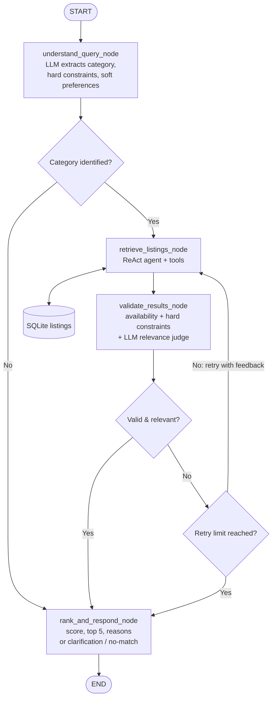

<div align="center">

# 🏠 AI-Powered Listing Recommendation Engine

**Describe what you want in plain English. Get the best 3–5 matches from a structured database, with reasons.**
*Domain-independent: rooms, cars, hotels and venues run on the same code.*


[Quick start](#-quick-start) · [How it works](#-how-it-works) · [Edge cases](#-edge-case-handling) · [Sample outputs](#-sample-query-outputs--test-results) · [Limitations](#-assumptions--limitations)

</div>

---

## 📑 Table of contents
1. [What it does](#-what-it-does)
2. [Quick start](#-quick-start)
3. [How it works](#-how-it-works)
4. [Domain independence](#-domain-independence)
5. [Dataset](#-dataset)
6. [Edge case handling](#-edge-case-handling)
7. [Sample query outputs / test results](#-sample-query-outputs--test-results)
8. [Assumptions & limitations](#-assumptions--limitations)
9. [Project structure](#-project-structure)
10. [Roadmap](#-roadmap)

---

## ✨ What it does

You type a request like:

> *"Find a furnished room in Pune with wifi and AC"*

and the engine:

1. **Understands** the request → category, **hard constraints** (must match), **soft preferences** (nice to have).
2. **Retrieves** candidates from SQLite using a **ReAct agent** with database tools.
3. **Validates** every result against the hard constraints **in code** and asks an LLM judge if the set really answers the request. If not, it **loops back** with feedback.
4. **Ranks** the valid listings and returns the **top 3–5 with short reasons**, or honestly says nothing matches.

**Design rule:** the LLM *extracts and explains*; **Python code does the strict matching**. That is what keeps the engine from inventing data.

---

## 🚀 Quick start

```bash
# 1. clone
git clone <your-repo-url>
cd <your-repo-folder>

# 2. virtual environment
python -m venv venv
venv\Scripts\activate          # Windows
# source venv/bin/activate     # macOS / Linux

# 3. install
pip install -r requirements.txt

# 4. add your Groq key
copy .env.example .env         # Windows   (macOS/Linux: cp .env.example .env)
# open .env and paste your key:  GROQ_API_KEY=...

# 5. run
python recommender.py
```

On first run the SQLite database is created and seeded automatically:

```
[listings_db] Seeded 36 listings into .../data/listings.db
```

<details>
<summary><b>🔑 Where do I get a Groq API key?</b></summary>

Create a free account at [console.groq.com](https://console.groq.com), open **API Keys**, create a key and paste it in `.env`. The model used is `openai/gpt-oss-120b` (hosted on Groq). Change it in one line in `recommender.py` if you prefer another model.
</details>

<details>
<summary><b>🧪 Queries to try</b></summary>

| Type | Query |
|---|---|
| Normal | `Find a furnished room in Pune with wifi and AC` |
| Numeric filter | `I want a car priced more than 5000 in Pune with sunroof` |
| Soft preference | `Find a car in Mumbai, preferably automatic with sunroof` |
| Vague | `I need something good and affordable` |
| No match | `Find a car in Pune under 1000` |
| Unknown city | `Find a room in Delhi` |
| Capacity too big | `Find a venue in Pune for 1000 people` |
| Availability | `Find an available car in Goa with sunroof` |
</details>

---

## 🧠 How it works


<details open>
<summary><b>Workflow as a diagram (Mermaid)</b></summary>


</details>

### The four nodes

| # | Node | What it does | Uses LLM? |
|---|---|---|---|
| 1 | `understand_query_node` | Turns free text into a structured object: `category`, `hard_constraints`, `soft_preferences`, `missing_info`, `is_vague`, `is_conflicting`, `note`. The schema of every category is read from the DB and given to the LLM, so column names are never hard-coded. Constraints on columns that do not exist are dropped. | ✅ structured output |
| 2 | `retrieve_listings_node` | A **ReAct agent** that calls tools to fetch candidates. On retry it receives the validator's feedback. | ✅ agent |
| 3 | `validate_results_node` | **Layer 1 (code):** drop unavailable listings and any that break a hard constraint. **Layer 2 (LLM):** judge whether the remaining set answers the request. | ✅ judge only |
| 4 | `rank_and_respond_node` | Scores soft-preference matches (cheaper wins ties), keeps the top 5, writes short reasons. Handles clarification and no-match replies. | ✅ reasons only |

### Agent tools (used inside node 2)

| Tool | Purpose |
|---|---|
| `get_schema(category)` | Columns, attribute keys, types and sample values, discovered at runtime |
| `get_distinct_values(category, column)` | Exact stored spellings (e.g. `Pune`, `wifi`) before filtering |
| `search_listings(category, filters)` | Structured filters → **parameterized SQL**. The LLM never writes raw SQL. |

### Retry loop
If the validator says the results are not relevant, the graph goes back to node 2 with feedback such as *"none of the fetched listings satisfy the hard constraints"*. The loop is capped (`MAX_RETRIES = 2`, so at most **3 attempts**) and then falls through to the no-match response. It can never loop forever.

---

## 🔁 Domain independence

Nothing about rooms, cars or hotels is written in the code or prompts.

- Common fields are real columns: `category, title, location, price, price_unit, capacity, available`.
- Everything domain-specific lives in one JSON column, `attributes`.
- Schemas are discovered at runtime from the data.

```
room  : {"furnished": true, "bathroom": "attached", "tags": ["wifi", "ac"]}
car   : {"fuel": "diesel", "transmission": "automatic", "seats": 7, "tags": ["suv", "sunroof"]}
hotel : {"rating": 4.5, "stars": 4, "tags": ["pool", "breakfast"]}
venue : {"indoor": true, "tags": ["ac", "parking", "stage"]}
```

<details>
<summary><b>➕ How to add a new domain (example: bikes)</b></summary>

Add rows with a new `category` to `LISTINGS` in `listings_db.py`:

```python
("bike", "Royal Enfield Classic 350", "Pune", 1200, "per day", 2, 1,
 {"engine_cc": 350, "gear": "manual", "tags": ["helmet included", "touring"]}),
```

Delete `data/listings.db` and run again. No change is needed in `recommender.py` or `helpers.py`; the new category and its attributes are picked up automatically.
</details>

---

## 🗂 Dataset

**36 listings** in a single SQLite table (`data/listings.db`), seeded from `listings_db.py`.

| Category | Count | Price unit | Domain-specific attributes |
|---|---|---|---|
| `room` | 10 | per month | furnished, bathroom, tags |
| `car` | 8 | per day | fuel, transmission, seats, tags |
| `hotel` | 9 | per night | rating, stars, tags |
| `venue` | 9 | per day | indoor, tags |

Deliberately tricky rows are included: listings just above a typical budget (₹7,500 room), **unavailable** listings (`available = 0`), cheap rooms in other cities, and cities that exist for one category but not another.

---

## 🛡 Edge case handling

| Case | Example | Behaviour |
|---|---|---|
| **Vague request** | `I need something good and affordable` | Category unknown → no search, no guessing. Asks a clarifying question and lists the categories it can search. |
| **Missing details** | `Suggest a venue in Mumbai` | Searches with what is known and states which details were not given (budget, capacity). |
| **Conflicting / unrealistic** | `luxury hotel under 500` | Flagged by the LLM; the answer explains the conflict. Strict code filtering still decides the results. |
| **No match** | `Find a car in Pune under 1000` | Says so honestly, then shows **near misses** (listings that fail exactly one requirement), clearly labelled with what they miss. |
| **Unavailable listings** | `available car in Goa with sunroof` | Unavailable listings are rejected in code. |
| **Hallucinated columns** | LLM invents a column | Dropped before search and reported as "could not apply (not in data)". |
| **No invented data** | always | Every listing shown comes from a database row. Hard constraints are verified in Python. |

---

## 🧪 Sample query outputs / test results

Run on Groq (`openai/gpt-oss-120b`). Full raw terminal log: [`samples_outputs.md`](samples_outputs.md).

| # | Query | Expected | Result | Status |
|---|---|---|---|---|
| 1 | `car priced more than 5000 in Pune with sunroof` | Toyota Fortuner only | Toyota Fortuner (₹5,500) | ✅ |
| 2 | `Suggest a venue in Mumbai` | Both Mumbai venues | Small Party Hall, Rooftop Party Space | ✅ |
| 3 | `available room in Pune under 6000` | Only available room under ₹6,000 | Budget Single Room Kothrud (₹5,000) | ✅ |
| 4 | `furnished room in Pune with wifi and AC` | Rooms with all three | 1BHK near Station, Hinjewadi, Baner | ✅ |
| 5 | `car in Mumbai, preferably automatic with sunroof` | Automatic + sunroof first | Hyundai Creta, Mahindra XUV700 | ✅ |
| 6 | `car in Pune under 1000` | No match + near misses | 3 near misses, each missing price | ✅ |
| 7 | `something good and affordable` | Ask for clarification | Clarifying question, no results | ✅ |
| 8 | `room in Delhi` | No match | No match + near misses in other cities | ⚠️ correct result, but wrongly says "requirements conflict" |
| 9 | `available car in Goa with sunroof` | No match (only Goa car is unavailable) | No match + near misses | ✅ |
| 10 | `hotel in Pune with swimming pool under 1000` | No match | No match, nothing close | ✅ |
| 11 | `venue in Pune for 1000 people` | No match (max capacity is 500) | 3 near misses, each missing capacity | ✅ |
| 12 | `venue in Pune for 100 people, preferably AC and parking` | Pune venues ≥ 100, AC + parking first | Conference Center, Grand Banquet, Lawn Garden | ✅ |

**11 of 12 passed cleanly, 1 passed with a wrong side-note.**

<details>
<summary><b>✅ Normal query: furnished room with wifi and AC</b></summary>

```text
You: Find a furnished room in Pune with wifi and AC

[1/4] understand_query ...
      category=room | hard=4 | soft=0
[2/4] retrieve_listings (attempt 1) ...
      fetched 3 candidates
[3/4] validate_results ...
      valid=3 rejected=0 relevant=True
[4/4] rank_and_respond ...

Top 3 recommendation(s):

1. Furnished 1BHK near Station  (Pune)
   Rs 6,500 per month | capacity 2 | {"furnished": true, "bathroom": "attached", "tags": ["wifi", "ac", "near metro"]}
   Why: Meets: location = Pune, furnished = True, tags contains wifi, tags contains ac
2. Spacious Room Hinjewadi  (Pune)
   Rs 7,500 per month | capacity 2 | {"furnished": true, "bathroom": "attached", "tags": ["wifi", "ac", "parking", "gym"]}
   Why: Meets: location = Pune, furnished = True, tags contains wifi, tags contains ac
3. Studio Apartment Baner  (Pune)
   Rs 9,500 per month | capacity 2 | {"furnished": true, "bathroom": "attached", "tags": ["wifi", "ac", "balcony", "parking"]}
   Why: Meets: location = Pune, furnished = True, tags contains wifi, tags contains ac
Details not given (so not applied): budget, capacity
```
</details>

<details>
<summary><b>✅ Numeric filter: car above ₹5000 with sunroof</b></summary>

```text
You: I want a car priced more than 5000 in Pune with sunroof

Top 1 recommendation(s):

1. Toyota Fortuner  (Pune)
   Rs 5,500 per day | capacity 7 | {"fuel": "diesel", "transmission": "automatic", "seats": 7, "tags": ["suv", "luxury", "sunroof"]}
   Why: Meets: location = Pune, price > 5000, tags contains sunroof
```
</details>

<details>
<summary><b>✅ Vague request → clarification</b></summary>

```text
You: I need something good and affordable

[1/4] understand_query ...
      category=None | hard=0 | soft=0
[4/4] rank_and_respond ...

I couldn't tell what kind of listing you're looking for.
I can search: car, hotel, room, venue.
Could you specify what you are looking for (e.g., car, hotel, room, or venue), the location, and your budget?
```
</details>

<details>
<summary><b>✅ No match → near misses (from real data)</b></summary>

```text
You: Find a car in Pune under 1000

[2/4] retrieve_listings (attempt 1) ... fetched 0 candidates
[2/4] retrieve_listings (attempt 2) ... fetched 0 candidates
[2/4] retrieve_listings (attempt 3) ... fetched 0 candidates

No listing meets all your requirements.

Closest options (each misses exactly ONE requirement):
1. Maruti Swift  (Pune) - Rs 1,800 per day
   Misses: price < 1000 (actual: 1800.0)
2. Toyota Innova Crysta  (Pune) - Rs 3,500 per day
   Misses: price < 1000 (actual: 3500.0)
3. Toyota Fortuner  (Pune) - Rs 5,500 per day
   Misses: price < 1000 (actual: 5500.0)

Tip: relax that requirement to get these options.
```
</details>

<details>
<summary><b>✅ Capacity too large → no match</b></summary>

```text
You: Find a venue in Pune for 1000 people

No listing meets all your requirements.

Closest options (each misses exactly ONE requirement):
1. Conference Center Hinjewadi  (Pune) - Rs 45,000 per day
   Misses: capacity >= 1000 (actual: 150)
2. Lawn Garden Venue  (Pune) - Rs 50,000 per day
   Misses: capacity >= 1000 (actual: 500)
3. Grand Banquet Hall  (Pune) - Rs 80,000 per day
   Misses: capacity >= 1000 (actual: 300)
```
</details>

<details>
<summary><b>✅ Unavailable listing is never recommended</b></summary>

```text
You: Find an available car in Goa with sunroof

[3/4] validate_results ...
      valid=0 rejected=1 relevant=False      <- the only Goa car is marked unavailable

No listing meets all your requirements.

Closest options (each misses exactly ONE requirement):
1. Honda City  (Delhi) - Rs 2,200 per day
   Misses: location = Goa (actual: Delhi)
...
```
</details>

<details>
<summary><b>✅ Missing details → still answers, says what was not applied</b></summary>

```text
You: Suggest a venue in Mumbai

Top 2 recommendation(s):

1. Small Party Hall  (Mumbai)
   Rs 30,000 per day | capacity 50 | {"indoor": true, "tags": ["ac", "sound system"]}
   Why: Meets: location = Mumbai
2. Rooftop Party Space  (Mumbai)
   Rs 60,000 per day | capacity 100 | {"indoor": false, "tags": ["dj", "bar", "city view"]}
   Why: Meets: location = Mumbai

Your request is broad. Could you tell me the expected capacity and budget for the venue?
```
</details>

---

## 📌 Assumptions & limitations

### Assumptions
- Prices are in Indian rupees; each category has one price unit (per month / day / night).
- `price` is the single cost column for every category. "Rent", "fare", "budget" and "cost" all map to it.
- A group size ("for 100 people") means `capacity >= value`.
- "Available" is a yes/no flag on each listing.
- A query targets **one category** at a time.
- Anything the user clearly requires is a **hard** constraint; "preferably / nice to have" is **soft** (affects ranking only).

### Limitations (known, honest list)
- **Availability has no dates.** It is a flag, not a booking calendar.
- **Exact matching for features.** `wifi` matches `wifi`, not `wi-fi`. The agent checks stored spellings with `get_distinct_values`, but there is no semantic or vector search yet.
- **Retries can be wasted.** In test 3 the LLM judge marked a correct result as "not relevant", causing 3 attempts before the correct answer was shown. The deterministic code check was right; the LLM judge was too strict.
- **Conflict flag can be wrong.** In test 8 (`room in Delhi`) the LLM labelled a missing city as a "conflict". The result list was still correct.
- **Reason sentences.** In the recorded runs the explanation step fell back to a template ("Meets: ..."). It is still accurate because it lists the verified constraints, but it is less natural than an LLM-written sentence.
- **Small dataset.** 36 sample rows; ranking is simple (soft-preference matches, then cheaper first).
- **LLM variability.** Output of query understanding can differ between runs and models.
- **Deprecation warning.** `create_react_agent` is deprecated in LangGraph 1.0 in favour of `langchain.agents.create_agent`. It works today; migration is a small change.
- **Terminal only.** No API or UI yet (see roadmap).

---

## 📁 Project structure

```
.
├── recommender.py      # state, schemas, agent tools, 4 nodes, routers, graph, terminal runner
├── helpers.py          # DB search, constraint checking, schema discovery, ranking helpers
├── listings_db.py      # SQLite connection, table creation, 36 sample listings
├── samples_outputs.md  # raw terminal output of the test queries
├── docs/
│   └── workflow.png    # workflow diagram
├── requirements.txt
├── .env.example        # copy to .env and add GROQ_API_KEY
└── data/
    └── listings.db     # created automatically on first run
```

---

## 🗺 Roadmap

- [ ] **FastAPI backend**: `POST /recommend` wrapping the existing graph
- [ ] **HTML / CSS frontend**: search box and result cards
- [ ] Semantic matching for features (embeddings) on top of exact tags
- [ ] Date-based availability
- [ ] Migrate to `langchain.agents.create_agent`
- [ ] Automated test suite from the sample queries above

---

## 🖥 UI Preview

<div align="center">


*Search box with recommendation cards*

</div>

<div align="center">

Built with **LangGraph · Groq · SQLite · Pydantic**

</div>
